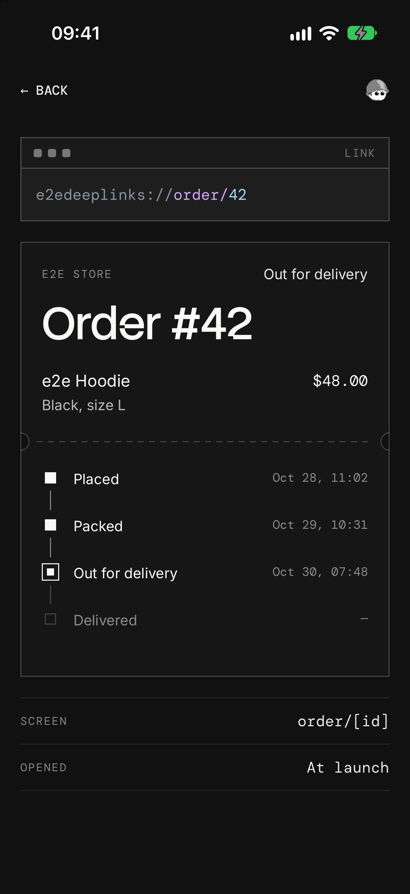

# e2e-deep-links

An Expo app where a link like `e2edeeplinks://order/42` opens order #42, the way a notification tap or an email link does, tested end to end on iOS and Android with [e2e](https://www.npmjs.com/package/e2e).



## How it works

- **Routes** (`src/app/`): Expo Router reads `e2edeeplinks://order/42` as `order/42` and opens `order/[id].tsx`. An id with no order shows "No order #…", and a path no route answers lands on `+not-found.tsx`.
- **How the link arrived** (`src/app/+native-intent.tsx`): every link the OS hands the app passes through `redirectSystemPath` first, which knows whether that link launched the app. The order screen shows "At launch" or "While running".
- **Back** (`src/app/_layout.tsx`): `anchor: 'index'` puts the orders list under a linked screen, so Back works after a cold start too.

Three orders live in the app. There's no backend, no account, and no key.

### Links to try

| Link                       | Opens                       |
| -------------------------- | --------------------------- |
| `e2edeeplinks://order/42`  | Order #42, out for delivery |
| `e2edeeplinks://order/41`  | Order #41, delivered        |
| `e2edeeplinks://order/999` | "No order #999"             |
| `e2edeeplinks://track/42`  | "This link goes nowhere"    |

Send one with the app closed or open: `xcrun simctl openurl booted <link>` on the iOS simulator, or `adb shell am start -a android.intent.action.VIEW -d <link>` on the Android emulator.

## Getting started

You need Node 22.22.3+ or 24.8+, and Xcode with an iOS simulator or the Android SDK with an emulator ([Expo's setup guide](https://docs.expo.dev/get-started/set-up-your-environment/)).

```bash
npm install
npm run ios
```

`npm run ios` (or `npm run android`) builds the app, installs it on the simulator, and starts Metro. The app needs a native build for its link scheme, so it doesn't run in Expo Go. Keep Metro on port 8081: on iOS, a link that launches the app can't pass the Debug build another port.

## End-to-end tests

`tests/links.e2e.ts` runs on iOS and Android. e2e's `device` fixture does what the OS does with a link: `device.closeApp()` kills the app, and `device.openLink()` hands it a link, cold or while it runs. The app's own screens use exact locators, and each test checks how the link arrived and where Back goes, so a link that opens the wrong screen, or nothing, fails.

| Test                                           | Expects                                                                 |
| ---------------------------------------------- | ----------------------------------------------------------------------- |
| A link opens the order from a cold start       | Order #42, "At launch"; Back shows your orders                          |
| A link opens the order while the app runs      | Order #42, "While running"; Back returns to order #41                   |
| An unknown order shows the fallback            | "No order #999"; See your orders shows the list                         |
| A link to no screen shows that it goes nowhere | "This link goes nowhere" at `/track/42`; See your orders shows the list |

iOS asks "Open in “e2e Deep Links”?" the first time a simulator opens the scheme, on behalf of `simctl`, and `device.openLink` doesn't answer it. So `tests/fixtures.ts` saves the answer on the simulator before each iOS test. After `npm run ios` or `npm run android`, run:

```bash
npx e2e run --target ios
npx e2e run --target android
```

Without `--target`, both run, in about 40 seconds, with no model calls. The runner starts Metro if it isn't running. To pick the simulator and emulator, set `IOS_DEVICE` and `ANDROID_DEVICE` in `.env.local` (see `.env.example`).

## Scripts

| Command             | Description                         |
| ------------------- | ----------------------------------- |
| `npm start`         | Start Metro                         |
| `npm run ios`       | Build and run the app on iOS        |
| `npm run android`   | Build and run the app on Android    |
| `npm run lint`      | Run ESLint                          |
| `npm run typecheck` | Run TypeScript                      |
| `npm run format`    | Format with Prettier                |
| `npm run test:e2e`  | Run the e2e tests on both platforms |
